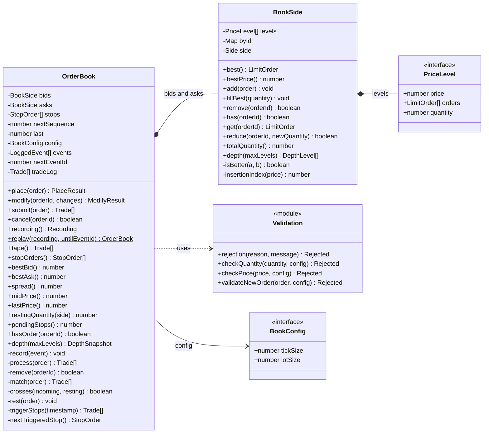
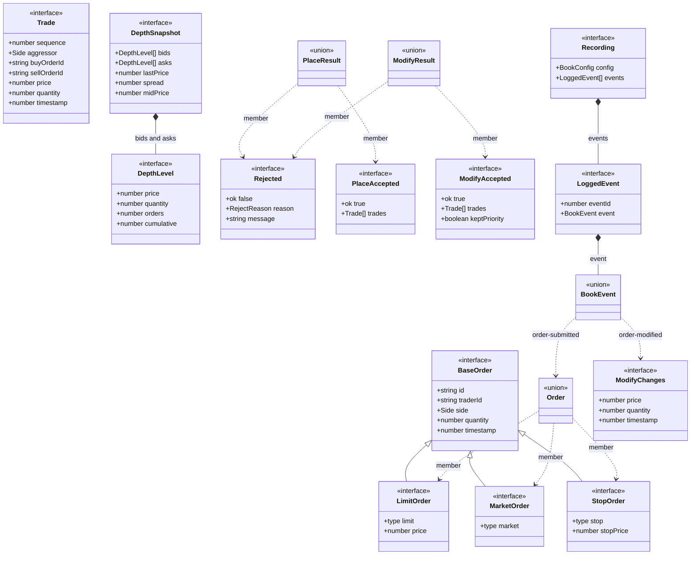

# Trading Arena engine: class diagrams (v0.1)

## Engine classes

## Data types

Notes: `Order`, `PlaceResult`, `ModifyResult` and `BookEvent` are TypeScript union types, so they are shown with the «union» marker. `BookSide` and `PriceLevel` are internal and are not exported from `index.ts`.
